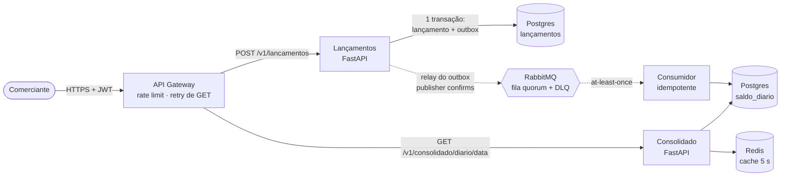

# Fluxo de Caixa: Lançamentos e Consolidado Diário

Solução para o desafio de **Arquiteto de Soluções**: um comerciante registra lançamentos (débitos e créditos)
e consulta o **saldo diário consolidado**.

O foco está nas **decisões de arquitetura**. O código existe para provar que elas funcionam:
isolamento de falha, zero perda, zero dupla contagem e vazão no pico.

## Resumo da solução



| Requisito | Como foi resolvido |
|---|---|
| Lançamentos **não pode cair** se o Consolidado cair | Nenhuma chamada síncrona entre os serviços. O evento é gravado no **outbox, na mesma transação** do lançamento, e publicado depois. Broker ou Consolidado fora: lançamentos seguem com 201 e os eventos esperam no outbox |
| Consolidado com **50 req/s e ≤ 5% de perda** | **Read model pré-calculado** (consulta O(1)), **cache Redis**, réplicas horizontais, **retry de GET** em outra réplica no gateway. Teste de carga k6 a 50 e a 100 req/s, com meta interna de ≤ 0,1% |
| Saldo sempre correto | `Idempotency-Key` no POST + dedupe por `event_id` no consumidor, **na mesma transação** da soma. Lançamento imutável (correção por estorno) |
| Segurança de consumo | OAuth2/JWT com **escopos por operação**, assinado com **chave assimétrica** (os serviços só têm a chave pública: conferem tokens, mas não emitem; HS256 e `alg=none` são recusados), comerciante extraído **só do token** (anti-IDOR), redes segmentadas, containers non-root e somente leitura |
| Integridade e auditoria | Eventos **assinados com Ed25519** e verificados antes de alterar o saldo: só Lançamentos tem a chave privada, o Consolidado recebe apenas a pública (confere, mas não consegue assinar); usuário de banco da aplicação **sem UPDATE/DELETE** nem DDL; broker com um usuário por serviço (só publica / só consome); `criado_por` + log de auditoria em cada escrita |
| Cadeia de suprimentos | Dependências verificadas no OSV, imagens fixadas por digest, Actions por SHA; **gitleaks, pip-audit e Trivy** no CI; Dependabot |

## Documentação de arquitetura

| # | Documento | Conteúdo |
|---|---|---|
| 1 | [Domínios e capacidades](docs/01-dominios-e-capacidades.md) | Mapa de capacidades, bounded contexts, context map, linguagem ubíqua, event storming |
| 2 | [Requisitos](docs/02-requisitos.md) | RFs com critérios de aceite, RNFs com métricas, premissas e perguntas ao negócio |
| 3 | [Arquitetura alvo](docs/03-arquitetura-alvo.md) | C4 (contexto e containers), sequências, cenários de falha, implantação em Azure, modelo de dados, contrato do evento |
| 4 | [Decisões (ADRs)](docs/04-decisoes-arquiteturais-adr.md) | Estilo arquitetural, outbox, CQRS, stack, idempotência, segurança, nuvem |
| 5 | [Arquitetura de transição](docs/05-arquitetura-de-transicao.md) | Migração de legado com Strangler Fig + CDC + ACL |
| 6 | [Segurança](docs/06-seguranca.md) | STRIDE, critérios para consumo de serviços, leste-oeste, segredos, DevSecOps, LGPD |
| 7 | [Observabilidade](docs/07-observabilidade.md) | Métricas de negócio e técnicas, SLOs, alertas, logs, tracing |
| 8 | [Custos](docs/08-custos.md) | Licenças e estimativa de infraestrutura (cenários Essencial e Corporativo) |
| 9 | [Evoluções](docs/09-evolucoes-futuras.md) | O que eu faria com mais tempo |

Diagramas C4 em PlantUML: [`docs/diagramas/`](docs/diagramas/).

## Como rodar localmente

**Pré-requisitos:** Docker 24+ com Docker Compose v2 e `make` (opcional: os comandos equivalentes estão no `Makefile`).

```bash
# 1. Configuração: cria o .env e gera um par de chaves Ed25519 para os eventos (troque as senhas do .env)
make env

# 2. Subir tudo: gateway em http://localhost:8080 (publicado só em 127.0.0.1)
#    Sobem também os jobs de migração (usuário dono do schema) e de topologia do broker.
make up            # docker compose up -d --build
make aguardar      # espera as réplicas ficarem healthy

# 3. Gerar um token de desenvolvimento pelo IdP local (container sem rede, único com a chave privada)
export TOKEN=$(make -s token)            # comerciante "loja-1", todos os escopos
```

### Usando a API

```bash
# Registrar um crédito (Idempotency-Key é obrigatório)
curl -s -X POST http://localhost:8080/v1/lancamentos \
  -H "Authorization: Bearer $TOKEN" -H "Content-Type: application/json" \
  -H "Idempotency-Key: venda-0001" \
  -d '{"tipo":"CREDITO","valor":"150.75","descricao":"venda balcão"}'

# Registrar um débito
curl -s -X POST http://localhost:8080/v1/lancamentos \
  -H "Authorization: Bearer $TOKEN" -H "Content-Type: application/json" \
  -H "Idempotency-Key: fornecedor-0001" \
  -d '{"tipo":"DEBITO","valor":"50.25","descricao":"fornecedor"}'

# Consolidado do dia (troque a data)
curl -s http://localhost:8080/v1/consolidado/diario/2026-11-10 -H "Authorization: Bearer $TOKEN"
# {"data":"2026-11-10","total_creditos":"150.75","total_debitos":"50.25","saldo_dia":"100.50",
#  "saldo_acumulado":"100.50","quantidade_lancamentos":2,"atualizado_em":"..."}

# Estornar um lançamento
curl -s -X POST http://localhost:8080/v1/lancamentos/<id>/estorno \
  -H "Authorization: Bearer $TOKEN" -H "Content-Type: application/json" \
  -H "Idempotency-Key: estorno-0001" -d '{"motivo":"cobrança duplicada"}'

# Listar lançamentos do dia
curl -s "http://localhost:8080/v1/lancamentos?data=2026-11-10" -H "Authorization: Bearer $TOKEN"
```

Swagger (ligado só no compose local; desligado por padrão): http://localhost:8080/lancamentos/docs
e http://localhost:8080/consolidado/docs · Console do RabbitMQ: http://localhost:15672 (admin do `.env`).

### Endpoints

| Método | Rota | Escopo | Descrição |
|---|---|---|---|
| POST | `/v1/lancamentos` | `lancamentos:write` | Registra crédito/débito (201; 200 em reenvio idempotente) |
| POST | `/v1/lancamentos/{id}/estorno` | `lancamentos:write` | Estorna (lançamento inverso na data de hoje) |
| GET | `/v1/lancamentos/{id}` | `lancamentos:read` | Detalhe |
| GET | `/v1/lancamentos?data=AAAA-MM-DD` | `lancamentos:read` | Lista do dia (paginada) |
| GET | `/v1/consolidado/diario/{data}` | `consolidado:read` | Totais, saldo do dia, saldo acumulado |

Erros no formato Problem Details (RFC 9457): `401` sem token ou token inválido, `403` sem escopo,
`409` conflito de idempotência ou estorno repetido, `422` validação ou regra de negócio, `429` rate limit.

## Testes

| Nível | O que cobre | Como rodar |
|---|---|---|
| Unitário (domínio) | Regras de valor, data, estorno, contrato do evento, projeção comutativa e idempotente | `make test` |
| API / componente | 401/403, escopos, `alg=none`, IDOR entre comerciantes, idempotência, validação, cache, Swagger desligado, logs de auditoria e de segurança, Problem Details | `make test` |
| Resiliência | Lançamentos com broker fora, falha no meio do lote, relay drenando backlog, mensagem inválida na DLQ, banco do Consolidado fora (mensagem retida, sem gastar o `x-delivery-limit`), erro inesperado com requeue | `make test` |
| Integridade da mensageria | Evento sem assinatura, forjado, de outra mensagem ou com chave errada vai para a DLQ sem alterar o saldo; rotação de chave | `make test` |
| **Segurança (pipeline)** | Segredos versionados (gitleaks), CVEs em dependências (pip-audit) e em imagens (Trivy) | `make seguranca` |
| Ponta a ponta | Fluxo real pelo gateway: lançar → consolidar; idempotência; borda sem rotas internas | `make e2e` (com o ambiente no ar) |
| **Demonstração do RNF** | Derruba consolidado + broker, lança, sobe de volta e confere que o saldo bate | `make resiliencia` |
| **Carga** | 50 req/s (critério) e 100 req/s (2x) com escrita em paralelo; thresholds de perda e p95 | `make carga` |

`make test` roda o estágio `test` do Dockerfile de cada serviço (`docker build --target test`):
o build falha se algum teste falhar. Para rodar sem Docker (Python 3.12):

```bash
cd services/lancamentos && python -m venv .venv && . .venv/bin/activate \
  && pip install -r requirements-dev.txt && pytest
```

## Estrutura do repositório

```
.
├── services/
│   ├── lancamentos/          # contexto Lançamentos (API + outbox relay)
│   │   ├── app/              # domain, service, repository, outbox, security, api, main
│   │   ├── migrations/       # SQL (append-only + trigger de imutabilidade + outbox)
│   │   └── tests/
│   └── consolidado/          # contexto Consolidado (API + consumidor)
│       ├── app/              # domain, service, repository, consumer, cache, security, api, main
│       ├── migrations/
│       └── tests/
├── infra/
│   ├── gateway/nginx.conf    # rate limit, roteamento, retry de GET, headers de segurança
│   ├── postgres/init/        # um banco por serviço; usuário de migração ≠ usuário de execução
│   ├── rabbitmq/             # topologia + usuários do broker com privilégio mínimo
│   └── prometheus/           # scrape + regras de alerta (SLOs e segurança)
├── loadtest/                 # k6
├── scripts/demo-resiliencia.sh
├── tests/e2e/
└── docs/                     # arquitetura, ADRs, segurança, custos…
```

## Limitações conhecidas (honestas)

- O IdP local é um emissor de desenvolvimento (Ed25519, container `idp-local` sem rede), não um IdP completo (sem login, consentimento ou revogação). Em produção os tokens vêm do IdP corporativo (RS256/JWKS), já suportado via `*_JWT_JWKS_URL`. Em qualquer caso os serviços só recebem chave pública e recusam algoritmo simétrico.
- Sem TLS entre os containers no ambiente local (tudo em redes internas e `127.0.0.1`); TLS é obrigatório no alvo.
- Dependências fixadas por versão, mas ainda sem *hash lock* (`--require-hashes`).
- Os repositórios Postgres são exercitados pelo e2e, não por testes de integração isolados (ver evoluções: Testcontainers).
- O adaptador para Azure Service Bus (nuvem alvo) está descrito, mas não implementado; o local usa RabbitMQ.
- Lista completa de riscos residuais de segurança: [docs/06-seguranca.md §6.8](docs/06-seguranca.md#68-riscos-residuais-conhecidos-e-aceitos-nesta-versão).
