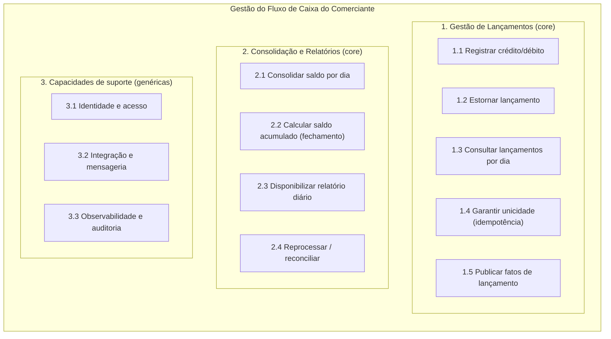
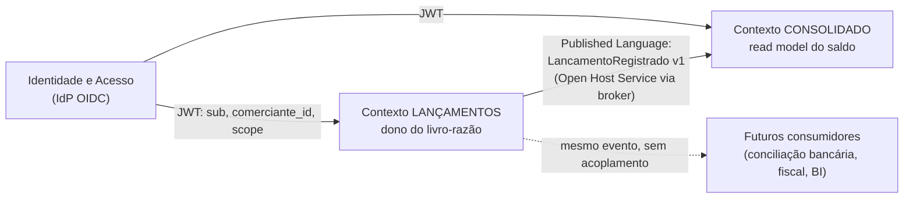

# 1. Domínios funcionais e capacidades de negócio

## 1.1 Visão do negócio

Um comerciante precisa **registrar o que entra e o que sai do caixa** (lançamentos de crédito e débito) e
**saber, ao fim de cada dia, quanto sobrou** (saldo diário consolidado). O valor está em duas coisas:

1. **Confiabilidade do registro**: um lançamento aceito nunca se perde nem é contado duas vezes.
2. **Visão do resultado**: o saldo consolidado fica disponível rapidamente, inclusive nos picos.

As duas têm perfis diferentes. Registrar é **escrita crítica, de baixo volume e que não pode parar**.
Consultar o consolidado é **leitura intensa, com picos e tolerante a alguns segundos de atraso**.
Essa diferença é a principal razão da decomposição a seguir.

## 1.2 Mapa de capacidades

| Capacidade | Tipo (DDD) | Por quê | Estratégia |
|---|---|---|---|
| Gestão de Lançamentos | **Core** | É o registro oficial do caixa. Erro aqui é prejuízo direto ao comerciante | Construir, modelo rico, banco transacional |
| Consolidação e Relatórios | **Core / apoio ao core** | É o que o comerciante enxerga como resultado | Construir como *read model* derivado de eventos |
| Identidade e acesso | Genérica | Não diferencia o negócio | Comprar/usar pronto (IdP OIDC: Entra ID, Keycloak, Cognito) |
| Mensageria | Genérica | Infraestrutura | Usar pronto (RabbitMQ / Azure Service Bus) |
| Observabilidade | Genérica | Infraestrutura | Usar pronto (OpenTelemetry + Prometheus/Azure Monitor) |

## 1.3 Bounded contexts e mapa de contexto

- **Lançamentos (upstream)** é dono dos dados. Publica um evento de integração versionado (`LancamentoRegistrado v1`).
  O modelo interno de persistência nunca é exposto.
- **Consolidado (downstream, conformista com a linguagem publicada)** não consulta o banco de Lançamentos
  nem chama sua API em tempo de execução. Ele constrói o próprio modelo a partir dos eventos.
- **Novos consumidores** (conciliação, fiscal, BI) assinam o mesmo evento sem mudar Lançamentos.
  É assim que a solução fica **reutilizável**.

## 1.4 Linguagem ubíqua

| Termo | Significado |
|---|---|
| Comerciante | Tenant. Toda informação pertence a um comerciante (`comerciante_id`), identificado pelo token |
| Lançamento | Fato financeiro imutável: tipo (CRÉDITO/DÉBITO), valor positivo, data de competência |
| Data de competência | Dia do caixa ao qual o lançamento pertence (padrão: hoje no fuso do comerciante) |
| Estorno | Novo lançamento de tipo inverso que anula outro. Lançamentos nunca são alterados nem apagados |
| Consolidado diário | Totais de créditos e débitos, saldo do dia e saldo acumulado de um comerciante em uma data |
| Saldo do dia | Créditos menos débitos da data |
| Saldo acumulado | Saldo de fechamento: soma dos saldos de todos os dias até a data |

## 1.5 Event storming (resumo)

| Ator | Comando | Agregado | Evento | Política / reação | Read model |
|---|---|---|---|---|---|
| Comerciante (PDV/app) | Registrar lançamento | Lançamento | `LancamentoRegistrado` | Ao registrar, atualizar o saldo do dia | Saldo diário |
| Comerciante | Estornar lançamento | Lançamento | `LancamentoRegistrado` (com `estorno_de`) | idem: o estorno é um lançamento inverso | Saldo diário |
| Comerciante / gestor | Consultar consolidado | n/a | n/a | n/a | Relatório diário |

**Invariantes do agregado Lançamento:** valor > 0 com até 2 casas, data de competência não futura,
estorno único e sem estorno de estorno, e unicidade por `Idempotency-Key` por comerciante.
