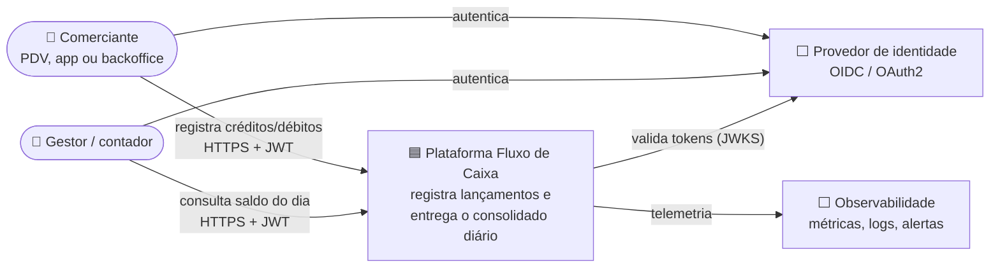
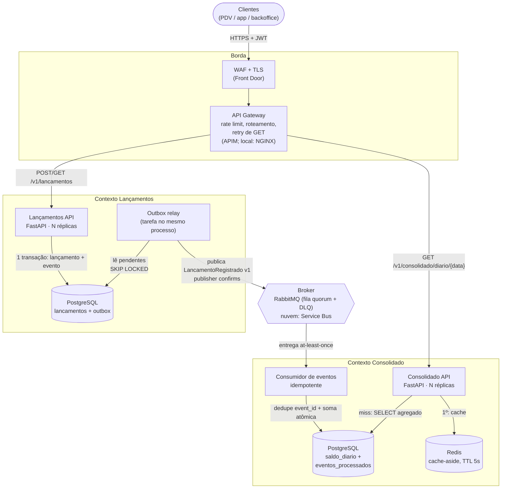
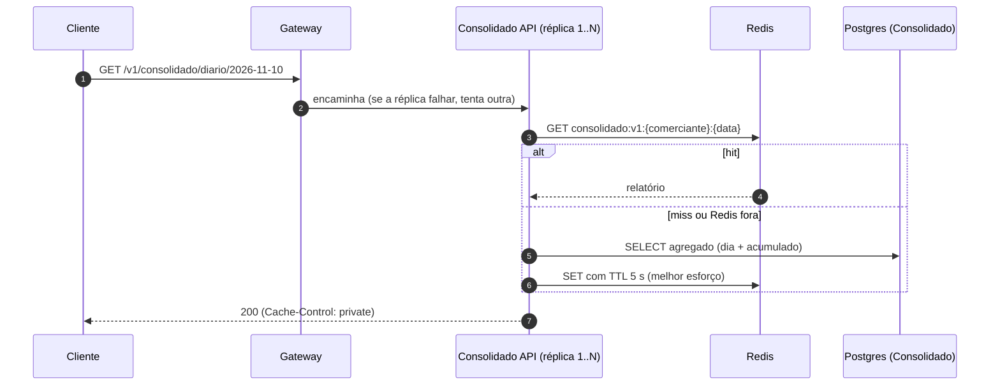
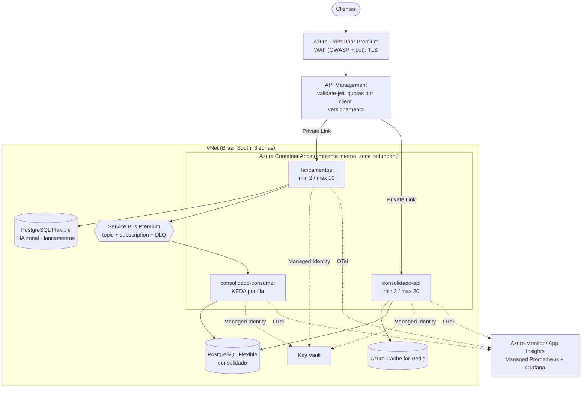
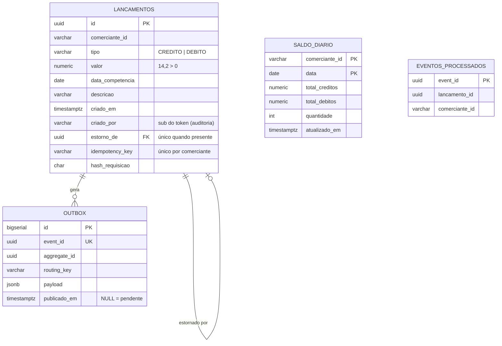

# 3. Arquitetura alvo

> Fontes PlantUML (C4) em [`diagramas/`](diagramas/). Os diagramas abaixo estão em Mermaid para
> renderizar direto no GitHub.

## 3.1 Estilo arquitetural em uma frase

**Dois microsserviços alinhados aos bounded contexts, integrados por eventos assíncronos (Transactional Outbox + broker),
com separação entre comando e consulta (CQRS): Lançamentos é a fonte da verdade transacional e Consolidado é um
read model pré-calculado e cacheado.**

Por que não um monolito, serverless ou chamadas síncronas: ver [ADR-001](04-decisoes-arquiteturais-adr.md#adr-001) e [ADR-002](04-decisoes-arquiteturais-adr.md#adr-002).

## 3.2 C4 nível 1: contexto



## 3.3 C4 nível 2: containers



**Não existe nenhuma seta entre Lançamentos e Consolidado.** Esse é o desenho que atende o RNF-01.

## 3.4 Fluxos principais

### Registrar lançamento (comando)

```mermaid
sequenceDiagram
    autonumber
    participant C as Cliente
    participant G as Gateway
    participant L as Lançamentos API
    participant DB as Postgres (Lançamentos)
    participant R as Outbox relay
    participant MQ as Broker
    participant K as Consumidor (Consolidado)
    participant CDB as Postgres (Consolidado)

    C->>G: POST /v1/lancamentos (JWT, Idempotency-Key)
    G->>L: encaminha (rate limit ok)
    L->>L: valida JWT, escopo e regras de domínio
    L->>DB: BEGIN; INSERT lancamento; INSERT outbox; COMMIT
    L-->>C: 201 Created (lançamento)
    Note over C,L: Aqui o comerciante já tem a resposta.<br/>Broker e Consolidado não participam.
    loop a cada 0,5 s
        R->>DB: SELECT pendentes FOR UPDATE SKIP LOCKED
        R->>MQ: publish (persistente, mandatory, confirm)
        MQ-->>R: ack do broker
        R->>DB: UPDATE outbox SET publicado_em
    end
    MQ->>K: LancamentoRegistrado v1
    K->>CDB: BEGIN; INSERT eventos_processados ON CONFLICT DO NOTHING;<br/>UPSERT saldo_diario += valor; COMMIT
    K-->>MQ: ack
```

### Consultar consolidado (query)



### Cenários de falha

| Falha | Efeito em Lançamentos | Efeito em Consolidado | Recuperação |
|---|---|---|---|
| Consolidado fora | **Nenhum** | Consultas 502/503 | Ao voltar, consome o backlog da fila |
| Broker fora | **Nenhum** (eventos acumulam no outbox) | Consultas OK, dados defasando | Relay drena o outbox com backoff |
| Redis fora | Nenhum | Consultas vão ao banco (latência maior) | Automática |
| Banco do Consolidado fora | Nenhum | Consultas falham; o consumidor **retém** as mensagens em mãos e repete a aplicação com backoff, sem devolvê-las à fila | Automática quando o banco volta. A queda não consome o `x-delivery-limit`: só após 20 min retida (`CONS_RETENCAO_INDISPONIBILIDADE_S`) a mensagem volta à fila e conta uma entrega, então a DLQ só é alcançada com ~3 h de banco fora |
| Erro inesperado ao aplicar um evento válido | Nenhum | Mensagem volta para a fila | Reentrega até `x-delivery-limit` (10), depois DLQ |
| Banco de Lançamentos fora | Registro indisponível (readiness 503) | Consultas OK | Failover HA do Postgres (zona) |
| Evento malformado | Nenhum | Mensagem vai para a DLQ, sem travar a fila | Alerta `MensagensNaDLQ` e reprocessamento manual |
| Evento duplicado | Nenhum | Ignorado (dedupe por `event_id`) | n/a |

## 3.5 Como cada requisito não funcional é atendido

| Tema | Decisões |
|---|---|
| **Escalabilidade** | Serviços stateless com escala horizontal (HPA/KEDA por CPU e RPS; consumidor por profundidade de fila). Leitura O(1) em read model. Cache distribuído. Relay concorrente com `SKIP LOCKED`. Particionamento natural por `comerciante_id` se um dia for preciso fazer sharding |
| **Resiliência** | Isolamento de falha por assíncrono. Outbox (sem perda). Consumidor idempotente (sem duplicidade). Fila quorum replicada + DLQ. Retry com backoff exponencial. Gateway com retry de GET em outra réplica. Cache *fail-open*. Health checks separados (`live`/`ready`) |
| **Segurança** | Ver [06-seguranca.md](06-seguranca.md): OAuth2/JWT, escopos, tenant pelo token, segmentação de rede, *least privilege*, segredos no Key Vault, imagem *non-root* e sistema de arquivos somente leitura |
| **Desempenho** | Pool de conexões, índices compostos, consulta agregada única, cache curto, sem N+1, payloads pequenos |
| **Observabilidade** | Métricas RED + métricas de negócio (backlog do outbox, defasagem, DLQ), logs JSON com `request_id`, alertas por SLO. Ver [07-observabilidade.md](07-observabilidade.md) |

## 3.6 Implantação alvo (Azure)

Escolhi Azure pela maturidade dos serviços gerenciados usados aqui e pela experiência de operação
(a equivalência com AWS está na tabela abaixo). Região: **Brazil South** (latência e LGPD), com zonas de disponibilidade.



| Componente local | Azure (alvo) | AWS (equivalente) |
|---|---|---|
| NGINX gateway | Front Door + WAF + API Management | CloudFront + WAF + API Gateway |
| Containers (compose) | Container Apps (ou AKS em escala maior) | ECS Fargate (ou EKS) |
| PostgreSQL 16 | Azure Database for PostgreSQL Flexible (HA zonal, PITR) | RDS PostgreSQL Multi-AZ |
| RabbitMQ | **Service Bus Premium** (topic/subscription, DLQ nativa) | Amazon MQ for RabbitMQ (mesmo código) |
| Redis 7.2 | Azure Cache for Redis | ElastiCache (Valkey) |
| IdP local (Ed25519, container `idp-local` sem rede) | Entra ID / Entra External ID (RS256 + JWKS) | Cognito |
| Prometheus | Azure Monitor managed Prometheus + Managed Grafana | AMP + AMG |
| `.env` | Key Vault + Managed Identity | Secrets Manager + IAM Roles |

> **Sobre o broker:** o código publica e consome por uma interface (`Publicador` / tratador de mensagem).
> Em Azure, o adaptador RabbitMQ é trocado por um adaptador Service Bus. Semântica idêntica (at-least-once,
> DLQ, dedupe no consumidor). Se a decisão for não mudar nada no código, a alternativa é AWS com Amazon MQ.
> Ver [ADR-007](04-decisoes-arquiteturais-adr.md#adr-007).
>
> **Topologia e permissões:** filas, tópicos e assinaturas são criados pela infraestrutura (local: job
> `rabbitmq-topologia`; nuvem: Bicep/Terraform). Os serviços só têm *Send* (Lançamentos) ou *Listen*
> (Consolidado), e cada evento é assinado com Ed25519: a chave privada fica só com Lançamentos e o
> Consolidado recebe apenas a pública. Ver [ADR-009](04-decisoes-arquiteturais-adr.md#adr-009).

## 3.7 Modelo de dados



`LANCAMENTOS`/`OUTBOX` ficam no banco de Lançamentos; `SALDO_DIARIO`/`EVENTOS_PROCESSADOS` no banco do Consolidado.
Uma trigger impede `UPDATE`/`DELETE` em `lancamentos` (imutabilidade garantida no banco).

## 3.8 Contrato do evento `LancamentoRegistrado v1`

```json
{
  "event_id": "0b6c9a1e-…",
  "event_type": "LancamentoRegistrado",
  "event_version": 1,
  "occurred_at": "2026-11-10T15:00:00+00:00",
  "comerciante_id": "loja-1",
  "lancamento_id": "5f1d…",
  "tipo": "CREDITO",
  "valor": "150.75",
  "data_competencia": "2026-11-10",
  "estorno_de": null
}
```

Regras de evolução: campos novos são opcionais (compatível); mudança incompatível vira `v2` com routing key
`lancamento.registrado.v2`, publicada em paralelo durante a migração dos consumidores.
