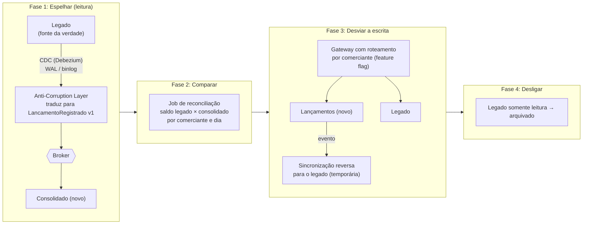

# 5. Arquitetura de transição (migração de legado)

## 5.1 Cenário assumido

Um cenário comum: o comerciante (ou uma rede de comerciantes) já usa um **sistema legado monolítico**,
por exemplo um ERP/PDV com banco relacional próprio, em que o caixa é uma tabela de movimentos e o "saldo do dia"
sai de um relatório noturno (batch). Os problemas típicos são: relatório só no dia seguinte, picos de consulta
derrubando o sistema inteiro e alterações diretas no banco sem trilha de auditoria.

## 5.2 Estratégia: Strangler Fig em 4 fases, sem big-bang

| Fase | O que muda | Critério de saída | Rollback |
|---|---|---|---|
| **1. Espelhar** | CDC lê o banco do legado sem tocar no código dele. Uma ACL traduz o modelo legado para o evento `v1`. O Consolidado novo é alimentado em paralelo | Consolidado novo processando 100% dos movimentos com defasagem < 5 s | Desligar o conector CDC (legado nem percebe) |
| **2. Comparar** | Reconciliação diária automática: totais do legado × consolidado novo; divergência gera alerta | 30 dias com divergência zero (ou explicada) | n/a: só leitura |
| **3. Desviar a escrita** | Gateway passa a enviar os lançamentos de um grupo piloto de comerciantes (feature flag) ao serviço novo. Eventos do novo são replicados de volta ao legado enquanto relatórios antigos dependerem dele | Piloto → 10% → 50% → 100% dos comerciantes, com SLOs atendidos em cada degrau | Virar a flag do comerciante de volta para o legado; a sincronização reversa mantém o legado íntegro |
| **4. Desligar** | Legado fica somente leitura, depois é arquivado (respeitando a retenção fiscal) | Nenhum consumidor dependente do legado | Restore do arquivo |

## 5.3 Pontos de atenção

- **Carga inicial (backfill):** snapshot do histórico do legado → eventos `v1` com `event_id` determinístico
  (ex.: UUIDv5 do ID legado) para que reexecuções sejam idempotentes.
- **ACL é obrigatória:** o modelo legado (ex.: valor com sinal, tipos de movimento proprietários) não pode vazar
  para o domínio novo. Mapeamentos desconhecidos vão para uma fila de quarentena, não para o consolidado.
- **Duas fontes de escrita ao mesmo tempo** só por comerciante, nunca para o mesmo comerciante (evita conflito).
- **Segurança da migração:** usuário de replicação do CDC com privilégio mínimo (só leitura no schema de movimentos),
  conector em rede privada e dados em trânsito cifrados.
- **Observabilidade da migração:** painel de divergência por comerciante, lag do CDC e backlog da ACL.

## 5.4 Por que o desenho alvo facilita a transição

- O Consolidado **só conhece o evento `v1`**. Não importa se o evento vem do outbox do serviço novo ou do CDC do legado.
- A idempotência por `event_id` permite reprocessar o backfill quantas vezes for preciso.
- O gateway já é o ponto de roteamento, então o desvio por comerciante é configuração, não código.
